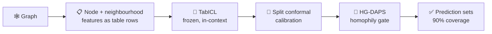

<!-- Header -->
<p align="center">
  
</p>

<p align="center">
  
</p>

<p align="center">
  
</p>

<p align="center">
  <a href="https://scholar.google.com/citations?user=I2OOw8sAAAAJ&hl=vi"></a>
  <a href="https://arxiv.org/abs/2610.08564"></a>
  
</p>

---

## 🧑‍💻 About me

```python
class Hien:
    def __init__(self):
        self.name     = "Phung Minh Hien"
        self.school   = "PTIT — Faculty of Information Technology"
        self.lab      = "AI Lab"
        self.now      = "Researching & writing a journal paper ✍️"
        self.research = ["Conformal Prediction", "Uncertainty Quantification",
                         "Tabular Foundation Models", "Graph ML"]
        self.building = "Vietnamese RAG Evaluation & Serving System"
        self.goal     = "A systems engineer who understands AI"

    def motto(self):
        return "A prediction is only as useful as its uncertainty."
```

## 🔬 Research

### 📄 Valid for Free: Homophily-Gated Conformal Prediction for Training-Free Node Classification with Tabular Foundation Models

*Nguyen Duy Long, **Phung Minh Hien**, Nguyen Trong Viet, Nguyen Thai Anh* · arXiv 2026 · [Paper](https://arxiv.org/abs/2610.08564) · [PDF](https://arxiv.org/pdf/2610.08564)

> Tabular foundation models can classify graph nodes **without training** on the graph. We give the first reliability study of this setting — and show the uncertainty guarantees come *for free*.

| | Finding |
|---|---|
| 🆓 **Training-free** | No training, validation fold or tuning on the target graph |
| 📐 **Exact guarantee** | A frozen in-context predictor makes split conformal prediction exactly valid in finite samples |
| 🎯 **Better calibrated** | TabICL has lower ECE than GCN + temperature scaling on 9/10 graphs (mean **0.019** vs **0.029**) |
| ✂️ **Smaller sets** | Our **HG-DAPS** score cuts prediction-set size by **5.8–17.1%** vs APS on homophilous graphs |



<details>
<summary><b>🧪 What I'm working on now</b></summary>
<br/>

- ✍️ Researching and writing a **journal paper** that extends this line of work
- 🧱 Building a **Vietnamese Retrieval/RAG Evaluation & Serving System** — evaluation first, then serving
- 📚 Strengthening ML foundations with PyTorch and MLOps tooling

</details>

## 🛠️ Tech stack

<p align="center">
  
</p>

<p align="center">
  
  
  
  
  
  
</p>

<p align="center">
  <b>Currently learning</b><br/>
  
</p>

## 🚀 Featured projects

| Project | Description | Stack |
|---|---|---|
| 🧑‍⚖️ [**Online-Judge**](https://github.com/hienphung910/Online-Judge) | An OOP project that helps students practise and improve their coding skills | Java |
| 💰 [**Salary-prediction**](https://github.com/hienphung910/Salary-prediction) | Linear Regression from scratch (Normal Equation) + interactive Streamlit app | Python · NumPy · Streamlit |
| 📖 [**Web-Python-Flask**](https://github.com/hienphung910/Web-Python-Flask) | Guestbook web app in two versions: a simple one and a modular one with 15 pytest tests | Python · Flask · pytest |
| 🧮 [**Calculator**](https://github.com/hienphung910/Calculator) | A small calculator written in Python | Python |

## 📊 GitHub stats

<p align="center">
  
  
</p>

<p align="center">
  
</p>

<p align="center">
  <picture>
    <source media="(prefers-color-scheme: dark)" srcset="https://raw.githubusercontent.com/hienphung910/hienphung910/output/github-snake-dark.svg" />
    <source media="(prefers-color-scheme: light)" srcset="https://raw.githubusercontent.com/hienphung910/hienphung910/output/github-snake.svg" />
    
  </picture>
</p>

<!-- Footer -->
<p align="center">
  <i>“A prediction is only as useful as its uncertainty.”</i>
</p>
<p align="center">
  
</p>
